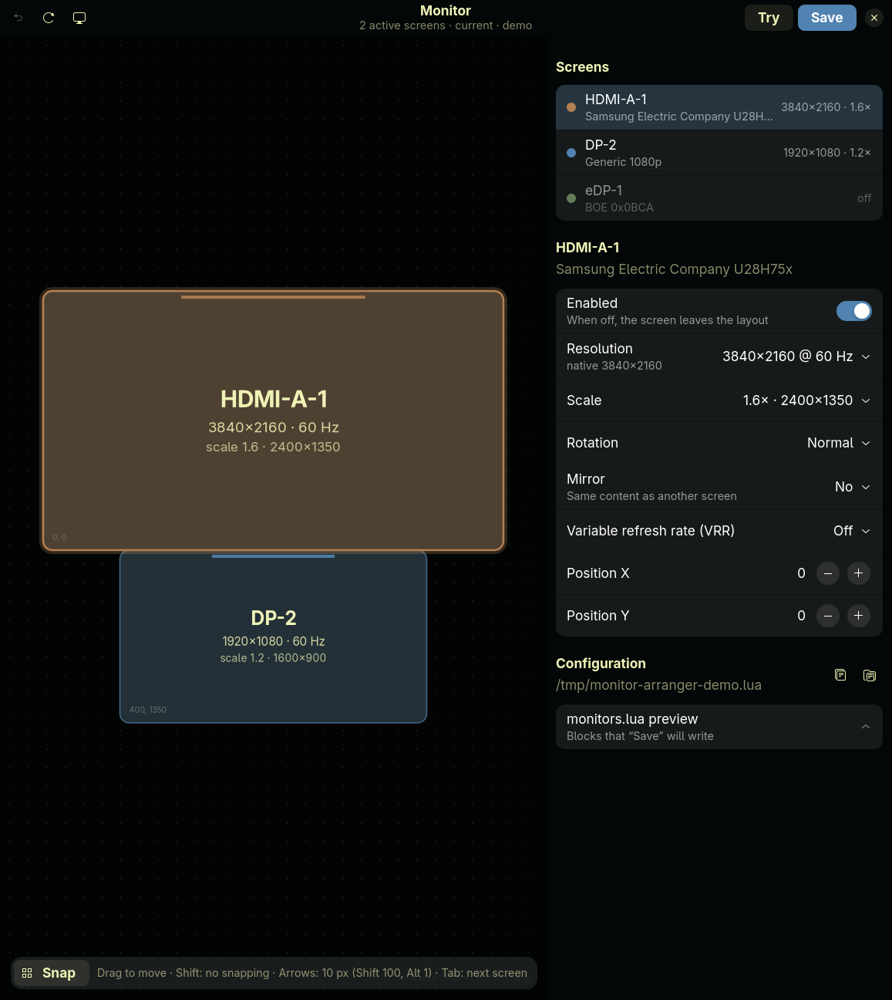

# Omarchy Monitor Arranger

A visual display arranger for [Omarchy](https://omarchy.org) / Hyprland.
Drag your monitors into place, pick resolution, scale, rotation, VRR and
mirroring, try the result live with an automatic rollback, then save it to
`~/.config/hypr/monitors.lua`.



> **Status:** standalone GTK4/libadwaita app (Python). A native Omarchy shell
> plugin is in development on the [`plugin`](../../tree/plugin) branch — see [Roadmap](#roadmap).

## Features

- **Drag & drop layout** with magnetic snapping to edges, adjacency and
  centres (hold <kbd>Shift</kbd> to disable), visible guide lines and
  hysteresis so it doesn't jitter at the snap boundary.
- **Per-monitor settings:** on/off, resolution & refresh rate (from the modes
  the panel reports), scale, rotation/flip (`transform` 0–7), mirroring, VRR,
  exact X/Y position.
- **Clean scales only:** offers just the scales that give an integer logical
  resolution (Hyprland works in 1/120 steps), each shown with the resulting
  logical size, e.g. `1.6× · 2400×1350`.
- **Neighbours follow:** changing scale, mode or rotation keeps the monitors
  that were touching it attached.
- **Layout warnings** for overlapping monitors or monitors the cursor can't
  reach, with a one-click *Fix* that re-aligns them.
- **Safe "Try":** applies the layout live via `hyprctl eval` and asks you to
  confirm; without an answer it rolls back after 15 seconds (useful when a
  screen goes black).
- **Careful "Save":** rewrites only the `hl.monitor({...})` blocks of your
  outputs, keeping comments, variables, the catch-all rule and fields it does
  not manage (`bitdepth`, `cm`, `reserved_area`, …). It matches `desc:`
  outputs, ignores commented-out rules, comments out duplicates instead of
  deleting them, makes a timestamped backup (keeps the last 10), reloads
  Hyprland and checks `hyprctl configerrors`, offering to restore on error.
- **Identify** (<kbd>Ctrl</kbd>+<kbd>I</kbd>): shows each output's name on the
  physical screen (needs `gtk4-layer-shell`).
- **Omarchy theme aware:** colours come from the active theme's `colors.toml`.
- **Undo** (<kbd>Ctrl</kbd>+<kbd>Z</kbd>), keyboard nudging (arrows 10 px,
  <kbd>Shift</kbd> 100, <kbd>Alt</kbd> 1), <kbd>Tab</kbd> to cycle monitors,
  <kbd>Ctrl</kbd>+<kbd>S</kbd> save, <kbd>Ctrl</kbd>+<kbd>Enter</kbd> try,
  <kbd>F5</kbd> reload.

## Requirements

- Omarchy with Hyprland ≥ 0.55 (Lua config — `hyprctl keyword` no longer
  works there, so the app uses `hyprctl eval`)
- Python ≥ 3.11, `python-gobject`, `gtk4`, `libadwaita`
- optional: `gtk4-layer-shell` for *Identify*

```bash
omarchy pkg add python-gobject gtk4 libadwaita gtk4-layer-shell
```

## Install

```bash
git clone https://github.com/FabioCuccaro/omarchy_monitor_arranger.git
cd omarchy_monitor_arranger
./install.sh
```

This installs `~/.local/bin/monitor-arranger` and a desktop entry, so it shows
up in the Omarchy app launcher as **Monitor Arranger**.

## Usage

```bash
monitor-arranger                  # real monitors via hyprctl
monitor-arranger --mock           # demo data, writes to a temp file
monitor-arranger --config FILE    # alternative monitors.lua
```

## Roadmap

- [x] English UI
- [ ] Native Omarchy shell plugin (QML) published on
      [plugins.omarchy.org](https://plugins.omarchy.org)
- [ ] "Arrange displays…" entry from the built-in Display panel / Omarchy menu
